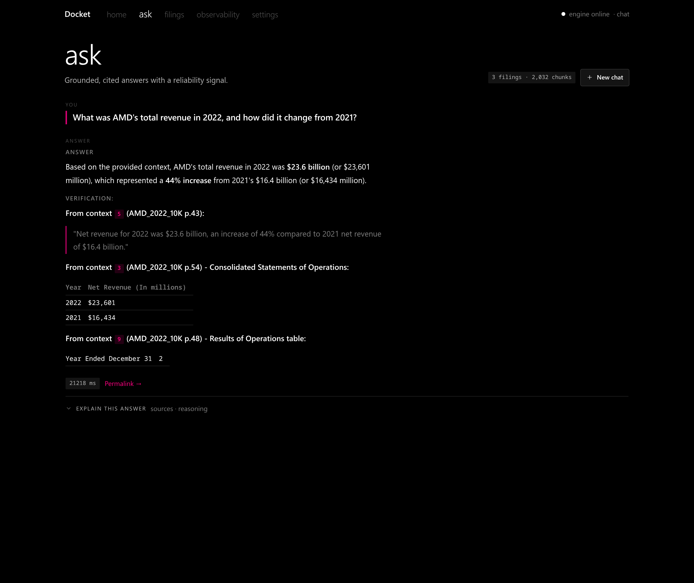
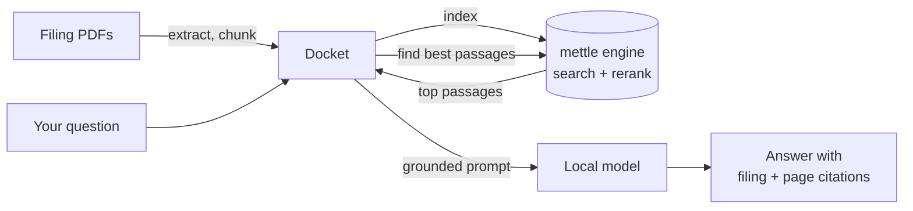
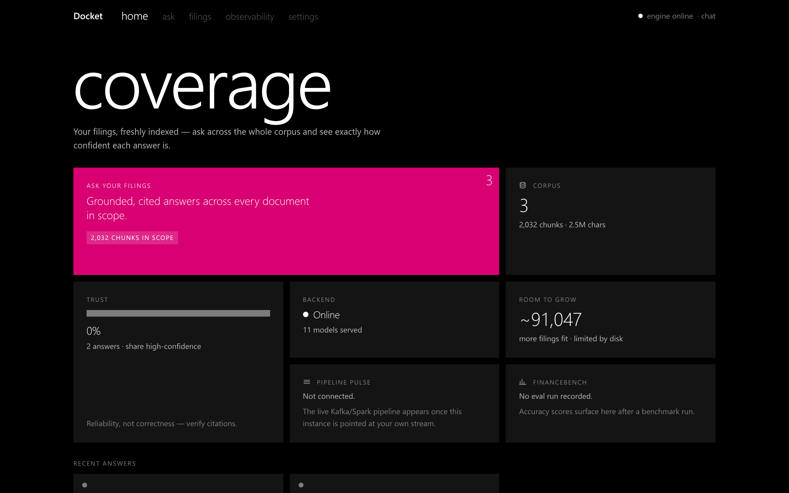
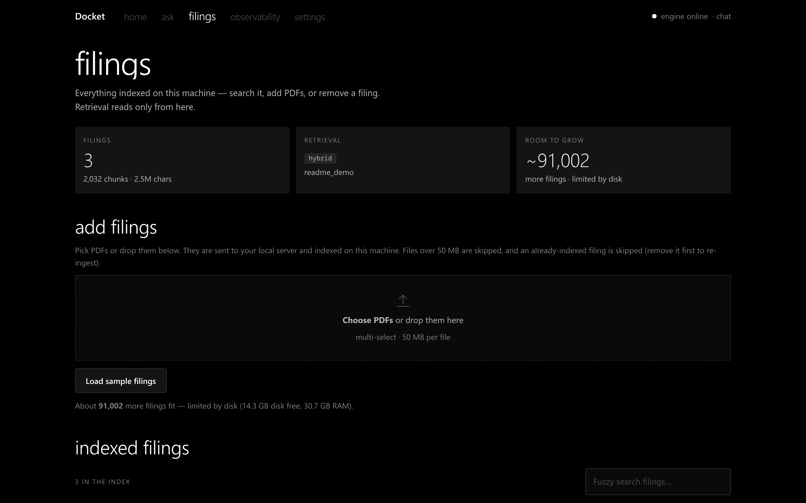
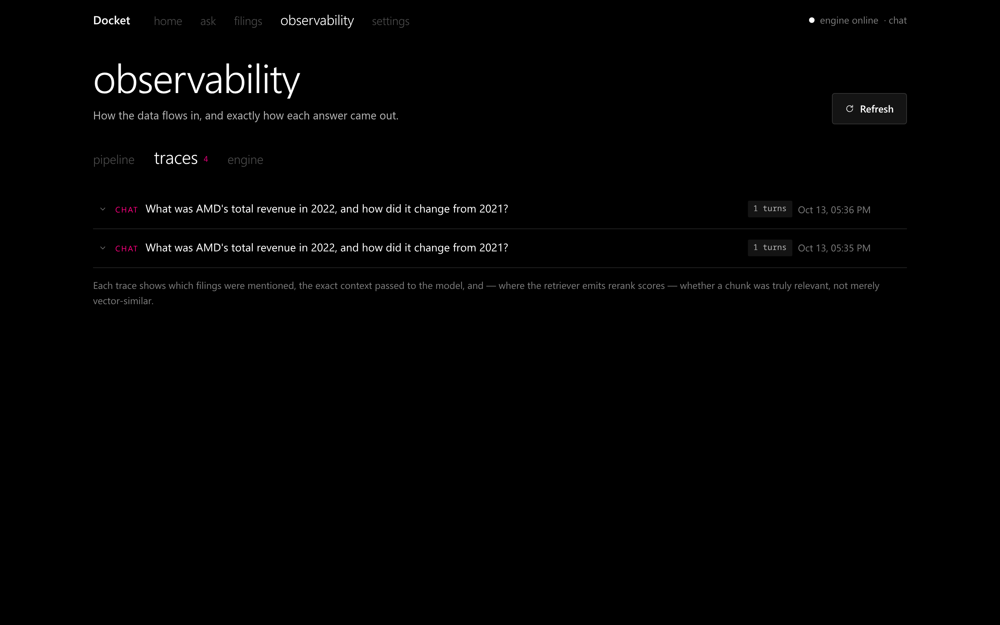

# Docket

A self-hosted research assistant for SEC filings. Drop in 10-Ks and 10-Qs, ask questions in plain English, and get answers that cite the exact filing and page they came from. Everything runs on your own machine with a small local model, so no filing or question ever leaves it.



## What it does

- **Answers with receipts.** Every answer points back to the filing and page it was drawn from, so you can check it in seconds.
- **Works across your whole coverage list.** Ask about one company or compare several; Docket searches every filing you have added.
- **Shows its work.** Each answer keeps a full trace: what was searched, which passages were picked, and the exact prompt the model saw.
- **Runs locally.** Retrieval and generation run on [mettle](https://github.com/adityam23/mettle), a local inference engine that fits on a 6 GB GPU.

## How it works



Docket handles the app side: the dashboard, ingesting filings, the question-answering agent and the citations. The [mettle](https://github.com/adityam23/mettle) engine does the heavy lifting: embeddings, search, reranking and the language model itself.

## Getting started

You need Python 3.11+, [uv](https://docs.astral.sh/uv/), an NVIDIA GPU with about 6 GB of memory, and a built [mettle](https://github.com/adityam23/mettle) engine.

```sh
git clone https://github.com/adityam23/docket && cd docket
uv sync --extra ingest --extra agent

# Let Docket start and manage the engine for you
export DK_ENGINE_BINARY=/path/to/mettled
export DK_METTLE_CONFIG=/path/to/mettle-config.toml

uv run dk serve
```

Open http://127.0.0.1:8760, go to **filings** and add some PDFs, then ask away on the **ask** page. If you already run mettle yourself, set `DK_BACKEND_URL` to its `/v1` address instead of the two engine variables.

Settings can also go in a `.env` file in the project folder.

### From the terminal

These talk to the engine directly, so keep `dk serve` (or your own mettle) running.

```sh
uv run dk ingest ~/filings          # add every PDF in a folder
uv run dk ask "What was AMD's revenue in 2022?"
uv run dk docs                      # list what's indexed
```

## A quick tour

**Home:** what's indexed and whether the engine is up.



**Filings:** add PDFs and watch each one get indexed.



**Observability:** a trace for every answer, step by step.



## Status

Docket is an early, actively developed project. Next on the list are a per-answer confidence signal and an interpretability "lab mode" that shows which parts of the model's internals drove an answer.

## License

GPL-3.0. See [LICENSE](LICENSE).
